# HR Analytics & Workforce Performance

## Project Overview

This project provides an end-to-end workforce and attrition analysis using the IBM HR Analytics Employee Attrition & Performance dataset. The objective is to evaluate workforce demographics, department and job-role turnover rates, compensation benchmarks, employee retention risks, and internal promotion pipelines.

The project connects a PostgreSQL database layer with an interactive Power BI reporting dashboard to deliver actionable HR business insights.

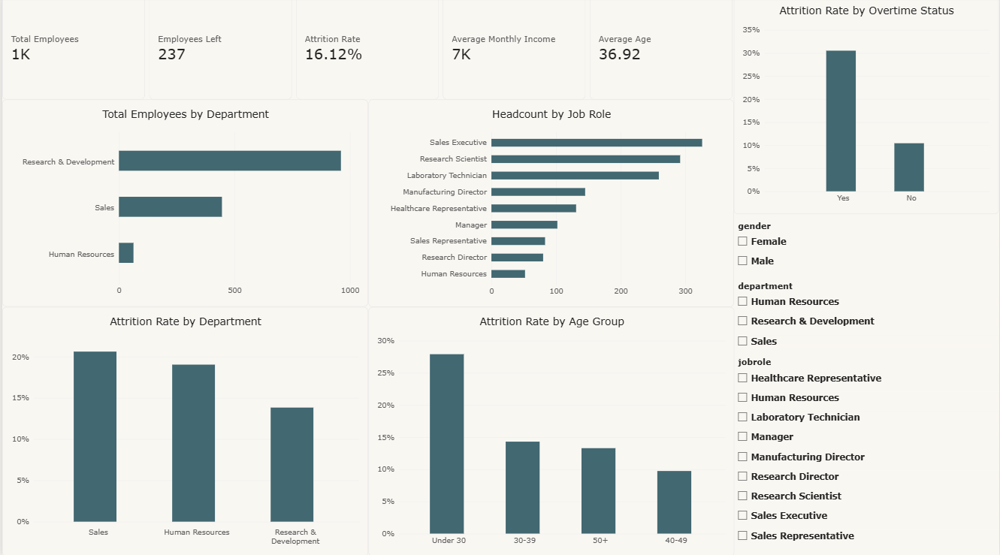

## Dataset

The IBM HR Analytics dataset contains detailed demographic, compensation, and performance records for organizational staff.

- **Granularity:** Employee-level records
- **Size:** 1,470 rows × 35 columns
- **Database:** PostgreSQL (`hr_analytics`)
- **Primary Table:** `employees` (`EmployeeNumber INT PRIMARY KEY`)

## Tools Used

- **Database Engine:** PostgreSQL / pgAdmin 4
- **Query Language:** SQL (CTEs, Window Functions `ROW_NUMBER`, `RANK`, `DENSE_RANK`, Aggregations, Conditional `CASE` statements)
- **BI & Modeling:** Power BI Desktop (Direct PostgreSQL connection, DAX measures, interactive multi-page dashboards)
- **Version Control:** GitHub

## Data Validation & Pipeline (SQL)

The raw CSV was imported into PostgreSQL and validated before BI modeling:

- Confirmed complete row count integrity (`1,470` records).
- Verified uniqueness of the primary key (`EmployeeNumber`) with zero duplicate IDs.
- Checked for missing/null values across key demographic and compensation columns.
- Formatted numerical and categorical datatypes to ensure schema consistency.

## Key Business Analysis & Findings

### 1. Overall Workforce & Attrition Baseline
The organization maintains a baseline headcount of 1,470 employees. Attrition rate was evaluated across the company to establish turnover benchmarks.

- **Total Headcount:** 1,470 employees
- **Attrition Metric:** Calculated as `(Employees Left / Total Employees) * 100`

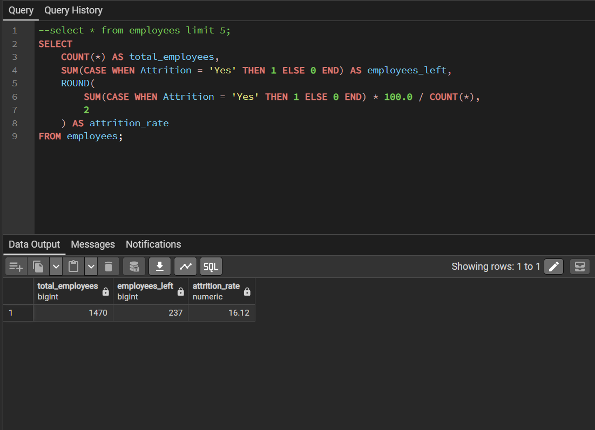

### 2. Attrition by Department & Job Role
Turnover was segmented across functional departments and specific job roles to isolate operational flight risks.

- **Department Breakdown:** R&D, Sales, and Human Resources turnover metrics were benchmarked against headcounts.
- **High-Risk Roles:** Entry and field-level roles (e.g., Sales Representatives, Laboratory Technicians) exhibited higher attrition compared to senior management.

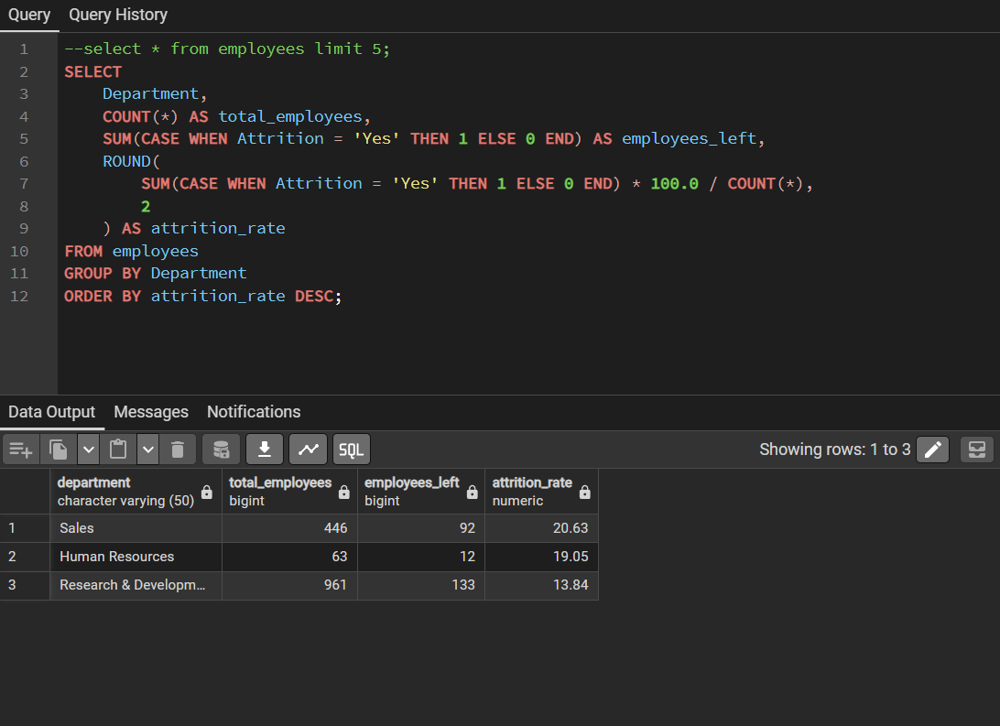

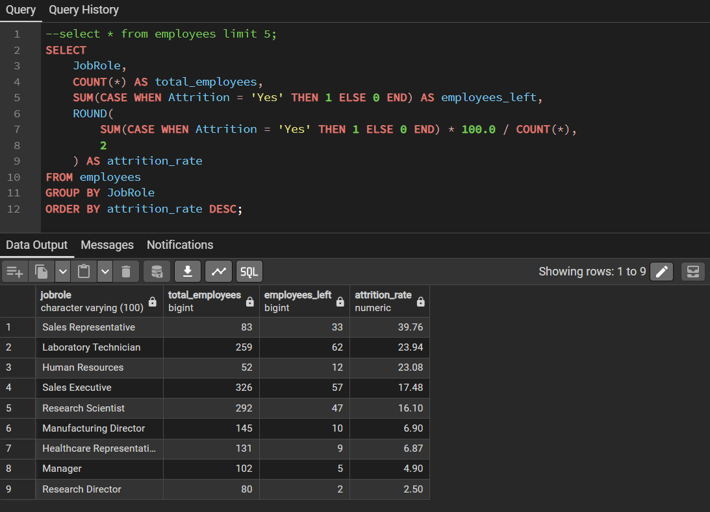

### 3. Departmental Compensation & Benchmarks
Salary distributions were analyzed across departments to assess compensation equity and identify outliers.

- **Department Average Salary:** Calculated average monthly income per business unit to establish baselines.
- **Compensation Outliers:** Identified highest earners per department and isolated staff earning above departmental averages using SQL CTEs and window partitioning.

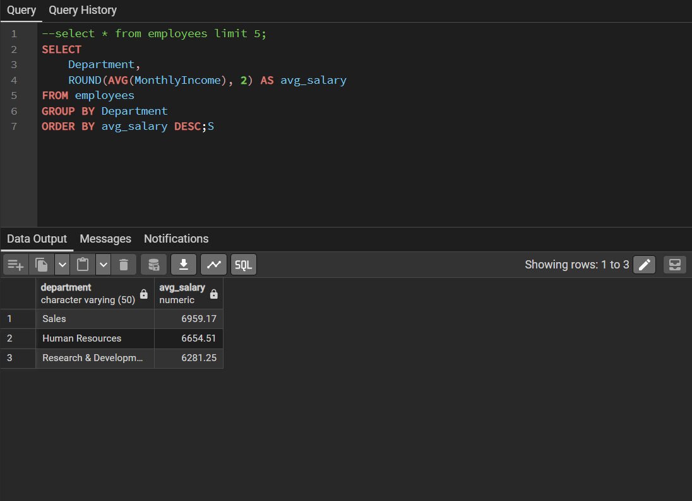

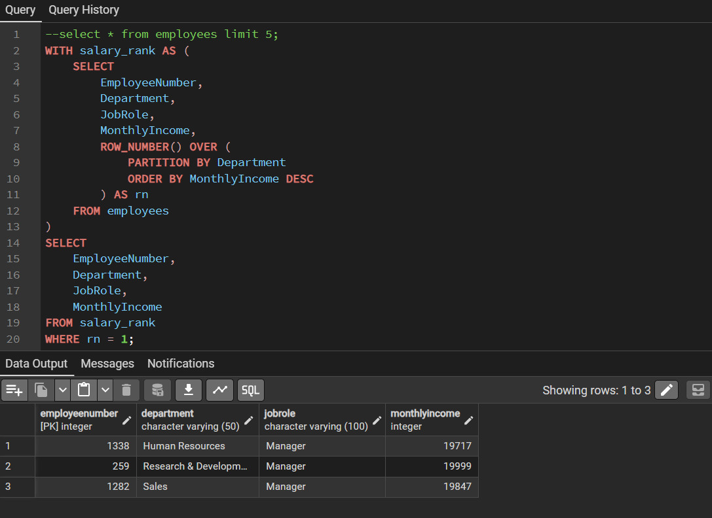

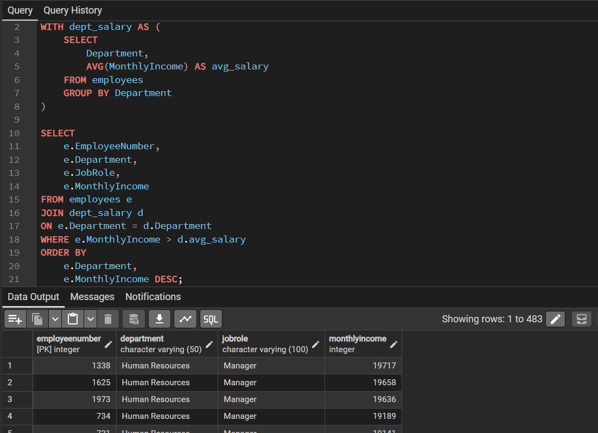

### 4. Promotion Eligibility Pipeline
Employees were evaluated for career advancement using a standardized business rule: `YearsSinceLastPromotion >= 5` and `PerformanceRating = 4`.

- Filters high performers who have remained without a promotion for 5 or more years to target retention and succession planning.

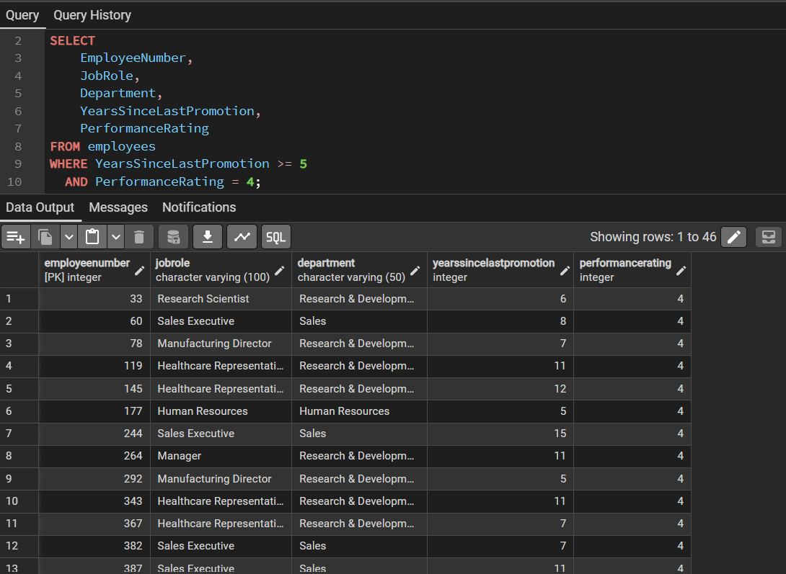

### 5. Employee Attrition Risk Classification
Staff members were categorized into operational risk segments to guide proactive HR retention strategies:

- **High Risk:** Employees working overtime (`OverTime = 'Yes'`) with low job satisfaction (`JobSatisfaction <= 2`).
- **Medium Risk:** Employees with moderate job satisfaction (`JobSatisfaction = 3`).
- **Low Risk:** All remaining employees maintaining satisfactory conditions.

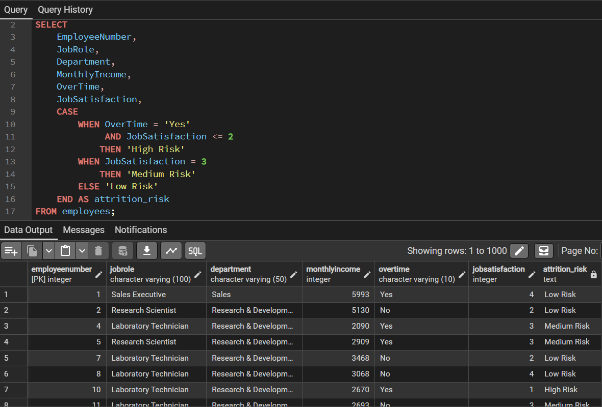

## Power BI Dashboard Implementation

Power BI connects directly to the PostgreSQL database to deliver a four-page interactive reporting suite:

1. **HR Overview:** Executive KPI summary (Headcount, Attrition Rate, Avg Income, Avg Age) and high-level departmental breakdowns.
2. **Attrition Analysis:** Deep dive into turnover drivers across Overtime, Salary Bands, Marital Status, and Age Groups.
3. **Compensation & Experience:** Salary hierarchy vs. total working experience, job level distributions, and compensation rankings.
4. **Employee Risk & HR Actions:** Action-oriented reporting showing high-risk headcounts and candidates eligible for promotion.

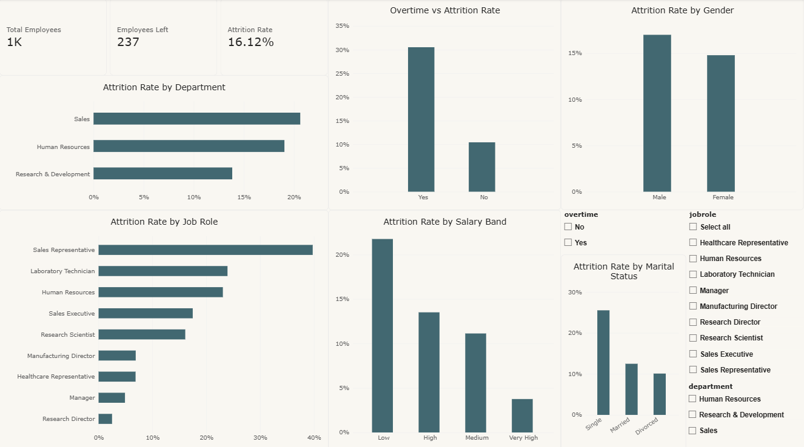

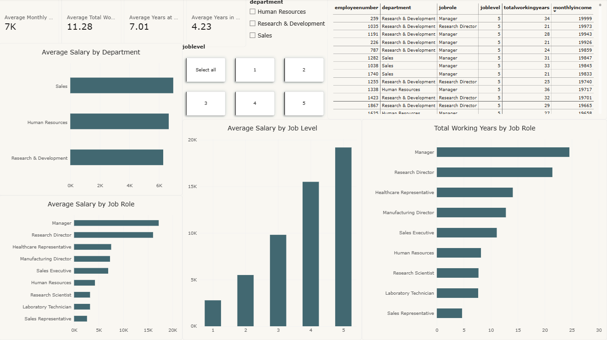

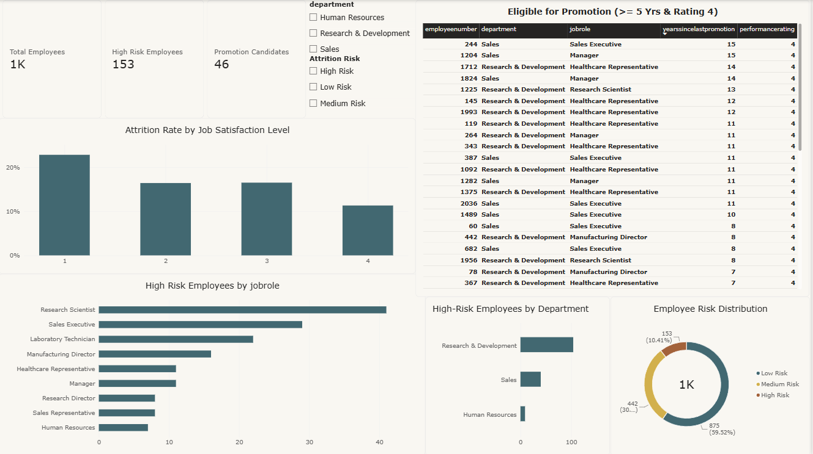

### Core DAX Measures Implemented

- `Total Employees = COUNTROWS(employees)`
- `Employees Left = CALCULATE(COUNTROWS(employees), employees[Attrition] = "Yes")`
- `Attrition Rate = DIVIDE([Employees Left], [Total Employees], 0)`
- `Average Monthly Income = AVERAGE(employees[MonthlyIncome])`
- `Average Age = AVERAGE(employees[Age])`
- `Average Total Working Years = AVERAGE(employees[TotalWorkingYears])`
- `High Risk Employees = CALCULATE(COUNTROWS(employees), employees[Attrition Risk] = "High Risk")`
- `Promotion Candidates = CALCULATE(COUNTROWS(employees), employees[Promotion Eligible] = "Eligible")`

## Strategic HR Recommendations

- **Mitigate Overtime Fatigue:** Overtime combined with low job satisfaction is the strongest indicator of turnover; review workload distribution and implement compensation or recovery policies for critical operational roles.
- **Accelerate Promotion Cycles for Top Talent:** Prioritize structured career progression reviews for high-performing employees who have gone 5 or more years without advancement to prevent talent loss.
- **Address Entry-Level Compensation Bands:** Standardize baseline compensation for roles in lower salary bands that experience elevated turnover, reducing early-tenure departures.
- **Target Departmental Benchmarks:** Monitor individual salary variances against department averages to ensure internal pay equity and maintain workforce morale.